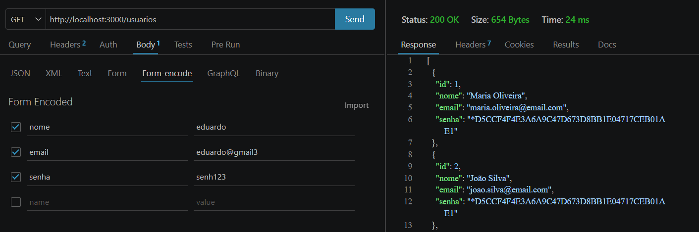
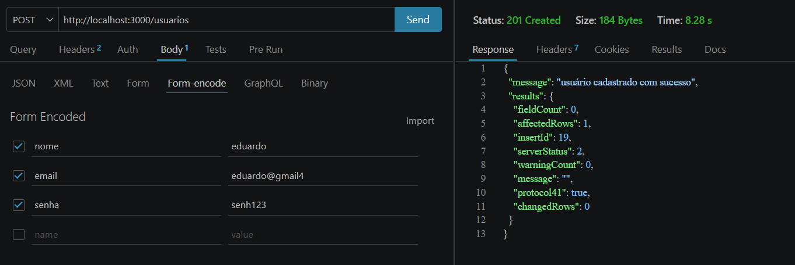
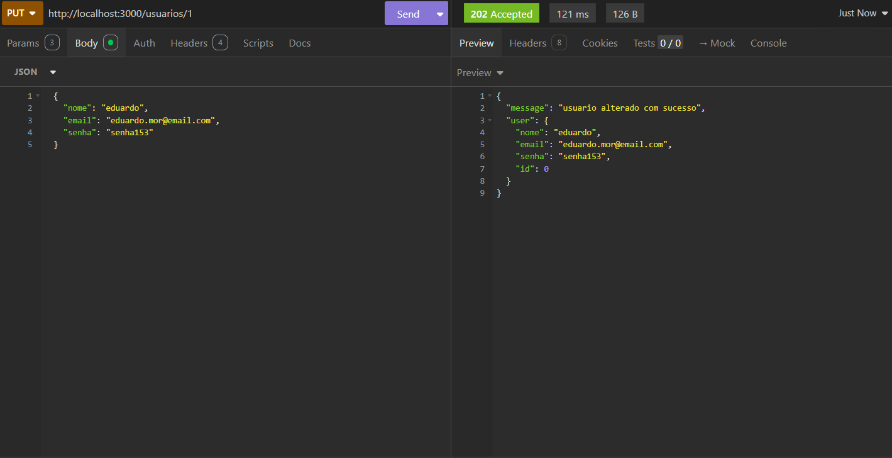
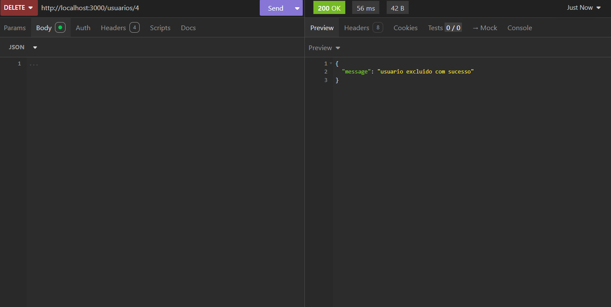
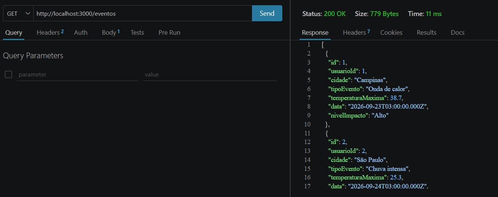
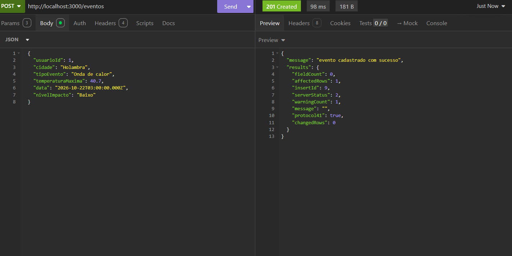
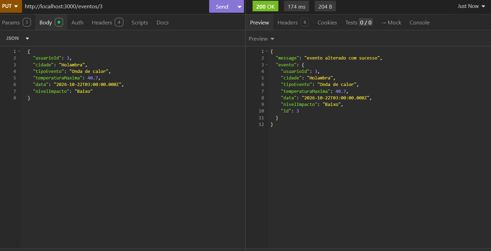

# Eventos climáticos

## Descrição
Desenvolver back-end com routes + banco de dados SQL

### Diagramas de desenvolvimento:

## Tecnologias utilizadas
- Javascript
- Node.js
- SQL
- DML
- DDL

## Instruções para testar

## Prints com thunder client

### Usuarios
Listar usuários com **/usuarios** (get)

Cadastrar usuário no **body** (post)

Alterar usuário com **/usuarios/id** no **body** (put)

Excluir usuário com **/usuarios/id** (delete)

### Eventos
Listar eventos com **/eventos** (get)

Cadastrar eventos no **body** (post)

Alterar evento com **/eventos/id** no **body** (put)

Excluir evento com **/eventos/id** (delete)
